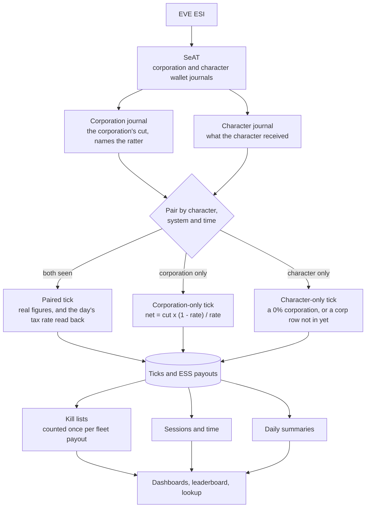

# Ratting Manager for SeAT

[](LICENSE)
[](https://github.com/eveseat/seat)

A ratting plugin for SeAT 5.x. It tracks one thing: who rats, where, when, how much they earn and what they kill. Every member sees their own ratting, and directors see the same for the whole corporation.

Ratting Manager 1.0 is in preparation. There is no release on Packagist yet.

Release history lives in the [CHANGELOG](CHANGELOG.md).

## Features

- **My Ratting** -- Every member's own page: ratting income, ISK per hour, hours, rats killed, active days, their rank by hours and the corporation tax their ratting paid, for this month, last month, the last 30 or 90 days or the last 12 months, across all their characters or one of them. Charts of income by month and by day, where they rat, what they kill by faction and by size, a weekday by hour map of when they rat in EVE time, bounty ISK per hour for each session, income by character, recent sessions, special spawns and personal records (best tick, session, day and month, longest session).
- **Insights** -- Where, when and how well, on My Ratting and the Corporation tab: favourite and best-paying system, most active and best-paying day of the week, most active and best-paying three hours of the day in EVE time, ratting streaks, typical and longest session, rats per hour, favourite target and how much of the income came from the ESS. Charts of hours by day of the week and by hour of the day, ISK per hour by system, and a table of every system ratted with its hours, share of the time, income, ISK per hour, rats and days. Directors also see the most players ratting at once, players per active day, income per player, and for each system how many players ratted there and who ratted there most.
- **Month by character** -- What each of a member's characters earned in a month (bounties, ESS, corporation tax, hours, ISK per hour, ticks and rats) with the month's total for all of them, and each character's income month by month.
- **Month by month** *(Director)* -- For the last 12 months: what the players earned, what landed in the corporation's wallet and the tax rate that makes, how many players and characters ratted, hours, ISK per hour and income per player, with a chart of earned against taxed.
- **Corporation tab** *(Director)* -- A second tab on the Dashboard with the corporation's totals and the corporation's cut, the median ISK per hour, how much of the ratting is tracked, a leaderboard, income by month and by day, who earns the income, when the corporation rats, active ratters per month, ratters coming and going (new, back after a gap, still ratting, stopped), efficiency by system, what the corporation kills, untracked ratters, players who have gone quiet, and special spawns. It opens on all tracked corporations, with any one of them a pick away.
- **Leaderboard** -- Members see their corporation ranked by hours ratted, with active days and their own row picked out, and nobody's ISK. Directors see every column: income, hours, ISK per hour, ISK per hour against the median player, rats, active days, the change on the period before, and coverage.
- **Charts that explain themselves** -- Every chart has a line under it saying what it shows.
- **Full lists** -- The dashboards show the first 10 rows of each long list (sessions, systems, special spawns, untracked ratters, players gone quiet, the leaderboard); **View all** opens the whole list on its own page, searchable and sortable, keeping the period, character or corporation picked.
- **Ratter Lookup** *(Director)* -- Every player who ratted in the last 90 days, searchable, each opening onto their ratting as they see it, plus where each of their characters' figures come from.
- **Members with no wallet token still count.** The corporation journal names the ratter on every tick it taxes, so a member who never added a wallet token still shows up, with their time exact and their income worked out exactly from the corporation's cut. They are listed under Untracked ratters so directors can ask them for a token.
- **Character lookups** -- Names and corporations for ratters SeAT does not know come from the journal rows themselves first, then from a background lookup (`ratting-manager:resolve-characters`): ESI first, then EVEWho and zKillboard when ESI is down, and no ESI calls while the error budget it shares with SeAT is low. Pages only ever read what has been found, so none of them waits on ESI; a character nobody has named yet shows as *Character info in progress* and the page refreshes itself once the lookup has them. The same lookup Mining Manager uses.
- **Fleets are counted properly.** Fleet members who share bounties each get a tick with the same time, system and list of rats. Their ISK adds up per character as it should, and the rats are counted once.
- **Special spawns** -- Officers, commanders, clone soldiers and capital rats are listed as they are killed, once per spawn however many fleet members shared it, along with any NPC types an admin adds to watch.
- **Discord and Slack notifications** *(Admin sets up)* -- Alerts for special spawns, ratting ships lost, outsiders ratting in home space, stalled data, untracked ratters and players gone quiet, and weekly and monthly reports. The **Director Report** has what the players earned, what landed in the corporation's wallet and the tax rate, and players ranked by income, hours, ISK per hour and corporation tax paid; the **Rankings** post ranks by hours only, with no ISK, for members' channels. Players are ranked as a main with all their alts. Each notification goes to the webhooks ticked for it, with a role of its own per webhook or a default; the **Routing Map** shows where everything goes and who it pings. Set up the way Structure Manager's are.
- **Diagnostics** *(Admin)* -- Health Checks, a Master Test that follows the data from the journals to the figures (including how close worked-out income comes to what characters really received), Settings Health, Data Integrity, a Tick Trace that follows one journal row through everything the plugin does with it, and Notification Testing, which sends a sample of any notification to any webhook and shows each webhook's delivery health.

## Requirements

- SeAT 5.x
- PHP 8.1+
- MariaDB / MySQL
- A director token with wallet access for each corporation to track, to see members who have no wallet token of their own

## Installation

```bash
composer require mattfalahe/ratting-manager
php artisan migrate
php artisan db:seed --class=RattingManager\\Database\\Seeders\\ScheduleSeeder
```

On SeAT Docker, migrations and the schedule seeder run when the containers restart.

After installation:

1. Open SeAT and go to **Ratting Manager > Settings**
2. Add the **corporations to track**: search by name or ticker, or open the list, and check the corporation's details before confirming: ticker, alliance, tax rate, members, how many of its characters are on SeAT and whether SeAT holds its bounty rows
3. Run the initial import, which brings in everything SeAT already holds:

```bash
docker exec -it seat-docker-front-1 php artisan ratting-manager:initialize
```

Without it, the schedule brings in the last 31 days within a day.

## Notifications

Nothing is sent until an admin sets it up:

1. **Settings > Webhooks**: add a Discord webhook (or a Slack incoming webhook, which gets plain text), for all tracked corporations or one.
2. **Settings > Notifications**: switch each notification on or off, tick the webhooks it goes to, and set who it mentions. A webhook's own role comes first, then the notification's default; *No ping* mentions nobody. With SeAT Broadcast or SeAT Connector installed, roles are picked by name.
3. **Settings > Routing Map**: check where everything goes.
4. **Diagnostics > Notification Testing**: send a sample of any notification to any webhook.

| Notification | When |
|---|---|
| **Special spawn** | An NPC of the chosen rank or above (clone soldier, commander, officer), a capital rat, or an NPC on the watch list is killed. One post per spawn. |
| **Ratting ship lost** | A tracked pilot loses a ship in the system they had a tick in shortly before. Needs SeAT to hold the killmail. |
| **Outsiders in home space** | More NPCs died in a home system in an hour than the tracked corporations killed there, by ESI's hourly count. Sent once that hour's journals are in, a few hours later. |
| **Data stalled** | A corporation's wallet journal stops coming in, or the import stops running. Again when it is back. |
| **Untracked ratter** | Ratters with no wallet token on SeAT, each posted once. |
| **Ratter gone quiet** | Players new to the Gone quiet list. |
| **Director Report** | Weekly on Monday and monthly on the 1st, for the period before. For directors. |
| **Rankings** | Same days, ranked by hours with no ISK. For members. |

Each alert remembers what it has sent and never sends the same thing twice.

## How the figures are worked out

Every 20 minutes of ratting pays one tick. SeAT keeps it in two places: the **corporation journal** holds the corporation's cut of it and names the ratter, and the **character journal** holds what the character received, for characters with a wallet token. Both carry the same time, the system and the list of rats killed, so the plugin pairs them.



| Figure | How |
|---|---|
| **Ratting income** | Bounties received plus ESS payouts received. |
| **Worked-out income** | For a tick only the corporation journal has: the cut times (1 - rate) / rate. At 15% tax a cut of 1.5M ISK means the character received 8.5M ISK. The rate for each day is read back from that day's paired ticks, so a change of tax rate is followed. Worked-out figures carry a dashed underline and are drawn striped in the charts. |
| **ESS payouts** | Paid out later by the ESS main bank as their own journal row. The corporation takes its cut of those too, so they are paired and worked out the same way, and count on the day they pay out. |
| **Hours** | Each tick stands for the 20 minutes before it. A player's time is every stretch any of their characters was ratting, counted once, so three alts ratting together for an hour are one hour. |
| **ISK per hour** | Income over hours. A session shows bounty ISK per hour only, since ESS is not tied to one session. |
| **Rats killed** | Each tick's kill list, counted once per fleet payout. |
| **Coverage** | How many of the ticks the corporation journal saw are also in the character's own journal. |
| **NPCs** | Placed by faction, size and rank from SeAT's SDE: the group name where it says ("Asteroid Guristas Battleship"), the NPC's mass where a group mixes sizes. Officers and commanders are read from their SDE groups, clone soldiers from their names. Anything else still counts, as Other, and Diagnostics lists it. |

Only the corporations picked in Settings are tracked. A character's ticks count for the corporation they were in at the time, so a member who leaves keeps their history where they earned it.

## Permissions

Each tier includes the ones below it, so a director does not also need Member.

| Permission | Tier | Description |
|---|---|---|
| `ratting-manager.view` | Base | Help page |
| `ratting-manager.member` | Member | My Ratting, and the leaderboard with rank and hours |
| `ratting-manager.director` | Director | The Corporation tab, the full leaderboard with every player's ISK and ISK per hour, and the Ratter Lookup |
| `ratting-manager.admin` | Admin | Settings, notifications and Diagnostics |

## Artisan Commands

| Command | Description |
|---|---|
| `ratting-manager:initialize` | Checks the setup and imports every bounty tick and ESS payout SeAT already holds |
| `ratting-manager:process` | Imports both journals and updates everything built on them. Reads two days by default; `--days=N` or `--from=YYYY-MM-DD` reads further back |
| `ratting-manager:resolve-characters` | Looks up names and corporations for ratters SeAT does not know. `--requested` takes only the characters pages asked for; `--stats` shows what the lookups hold |
| `ratting-manager:trace-tick {journal_id}` | Shows what the plugin did with one journal row |
| `ratting-manager:notify` | Checks every alert and sends what is new. `--only=special_spawn` runs one |
| `ratting-manager:poll-system-kills` | Keeps ESI's hourly NPC kill counts for the home systems, for the Outsiders alert |
| `ratting-manager:send-reports` | Sends the Director Reports and Rankings that are due. `--weekly` or `--monthly` for one kind, `--force` to send the last period again |
| `ratting-manager:import-corp-journal` | The corporation journal step of `process` on its own |
| `ratting-manager:import-character-journal` | The character journal step on its own |
| `ratting-manager:update-tax-rates` | Reads tax rates back from paired rows and works out corporation-only rows |
| `ratting-manager:snapshot-tax-rates` | Keeps today's corporation tax rate for days with no paired rows |
| `ratting-manager:sync-npc-types` | Places NPC types not placed yet |
| `ratting-manager:build-sessions` | Groups ticks into sessions |
| `ratting-manager:update-daily-summaries` | Rebuilds the daily summaries |

Every command that writes takes the same lock, so a manual run never overlaps the scheduled one.

### Schedule

| Command | When |
|---|---|
| `ratting-manager:process` | Twice an hour |
| `ratting-manager:process --days=31` | Daily. A member who adds a wallet token brings 30 days of journal with them, and this pairs those days with the corporation rows already imported |
| `ratting-manager:resolve-characters --requested` | Every minute: the characters pages asked for |
| `ratting-manager:resolve-characters` | Every 10 minutes: ratters nobody has looked up yet, and answers due another look |
| `ratting-manager:notify` | Twice an hour, five minutes after the import |
| `ratting-manager:poll-system-kills` | Hourly. ESI updates its kill counts once an hour |
| `ratting-manager:send-reports` | Daily at 11:20 EVE. Each report goes once per period |

The schedules are added once. Changes you make to them in SeAT are kept on update.

## Data freshness

A tick reaches the pages about one to two hours after it pays out: ESI caches the wallet journal for an hour, SeAT pulls it about hourly, and the plugin reads it every half hour.

Dashboard figures are cached until the next import changes them, so a page shows the same figures between imports however often it is opened.

## License

GPL-2.0-or-later. See [LICENSE](LICENSE).
